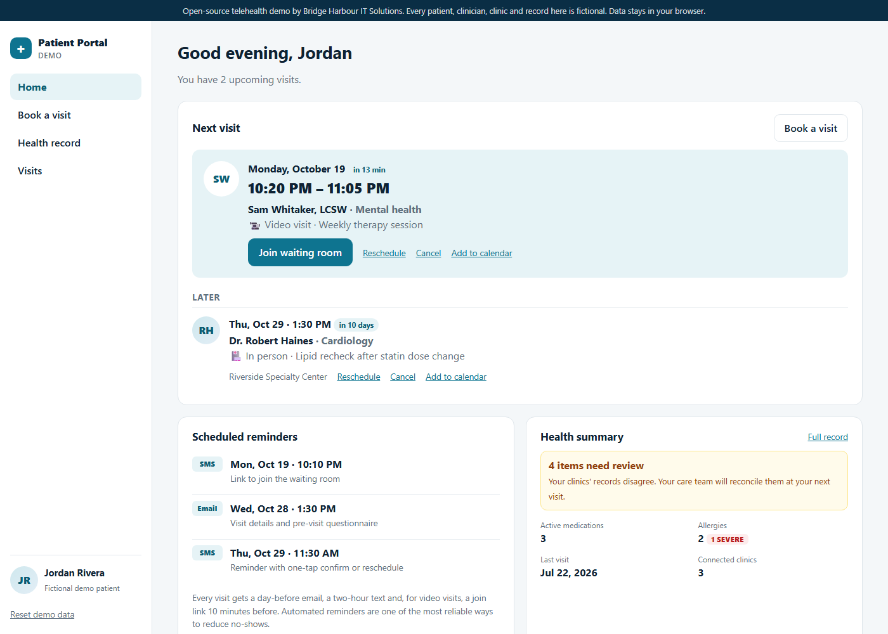

# Patient Portal & Telehealth — Demo

A patient portal covering appointment booking with real scheduling rules, automated reminders, a single health record merged from several clinics' systems, and a virtual waiting room for video visits.

**[Live demo →](https://saisampath138.github.io/telehealth-portal-demo/)**



> **This is an open-source demo, not client code.** Bridge Harbour IT Solutions built it to show how we approach telehealth projects like the one in our *Patient Portal & Telehealth App* case study. Client code stays private. Every patient, clinician, clinic and record here is fictional, and data is stored only in your browser. This is not a medical device or a compliance-certified system.

## What it shows

- **Booking with real rules** (`src/lib/slots.ts`, `src/lib/booking.ts`)
  - Slots are generated from each clinician's weekly hours and visit length, with an hour's notice required.
  - Other patients' bookings and your own visits elsewhere are excluded.
  - Every booking is re-validated when you confirm it. A slot taken in the meantime, an overlap with one of your other visits, or an off-schedule time is rejected with a clear message.
  - Rescheduling is atomic: the original visit is only released once the new time is confirmed.
- **Reminders built to reduce no-shows.** Each visit gets a day-before email and a two-hour text. Video visits also get a join link 10 minutes before. Reminders that would already be in the past are dropped. Every visit can be added to a calendar as an `.ics` file.
- **Unified health record** (`src/lib/records.ts`)
  - Records from three clinic systems are merged by standard codes: RxNorm for medications, ICD-10 for conditions, LOINC for labs and CVX for vaccines.
  - Duplicates are shown once, with every source credited.
  - Disagreements are **flagged, not silently resolved**: a statin dose that differs between clinics, a medication stopped in one system but active in another, conflicting allergy severity, and a condition marked resolved at one clinic but active at another.
  - Allergies keep the most severe classification and every reported reaction. Out-of-range labs are highlighted, with their trend.
- **Virtual waiting room.** Device check, check-in, queue position, then a simulated call with mute and camera controls. The demo never asks for camera or microphone access. A production build would embed a video provider's SDK at this point.

## Running it

```bash
npm install
npm run dev      # http://localhost:5173
npm test         # Vitest: slot generation, booking rules, reminders, record merging
npm run build    # type-check + production build into dist/
```

Use **Reset demo data** in the sidebar to restore the starting visits. The first load always includes a video visit about 10 minutes away, so you can try the waiting room immediately.

## How it's built

```
src/
  lib/
    slots.ts       weekly schedules → bookable slots (DST-safe local-time maths)
    booking.ts     validation, booking, atomic reschedule, cancel, reminder plan
    records.ts     multi-source record merge with conflict detection
  data/seed.ts     fictional clinics, clinicians, schedules and source records
  store.ts         bookings persisted in localStorage, seeded on first visit
  ui/              home, booking flow, health record, visits, waiting room
  main.ts          hash router
```

**Design choices**

- **Validate at confirm time, not just when listing.** Showing a slot doesn't guarantee it'll still be free when the patient taps Confirm. The booking call re-checks everything and fails safely.
- **Never auto-resolve clinical data.** The merge shows the most recent value but keeps every source visible and flags disagreements for a clinician, which is what a reconciliation workflow needs.
- **Local-time maths through the `Date` constructor.** Slots are built as local midnight plus minutes, so clock changes don't shift appointments by an hour.
- **No framework.** TypeScript and Vite only, about 13 kB of JavaScript gzipped.

## Deployment

Each push to `main` runs the tests, builds, and publishes `dist/` to GitHub Pages (`.github/workflows/deploy.yml`).

## License

[MIT](LICENSE)
